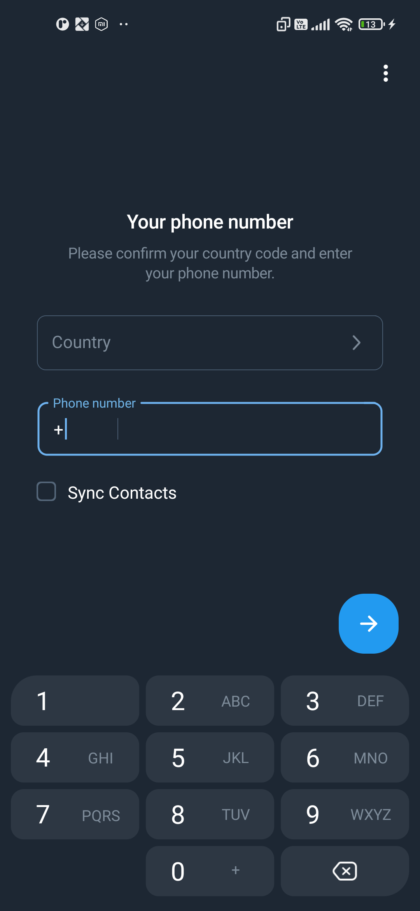
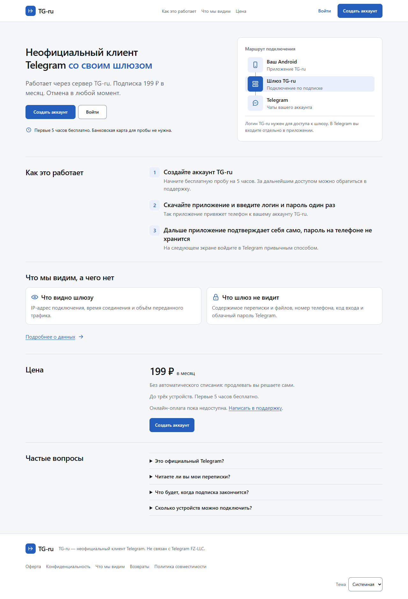
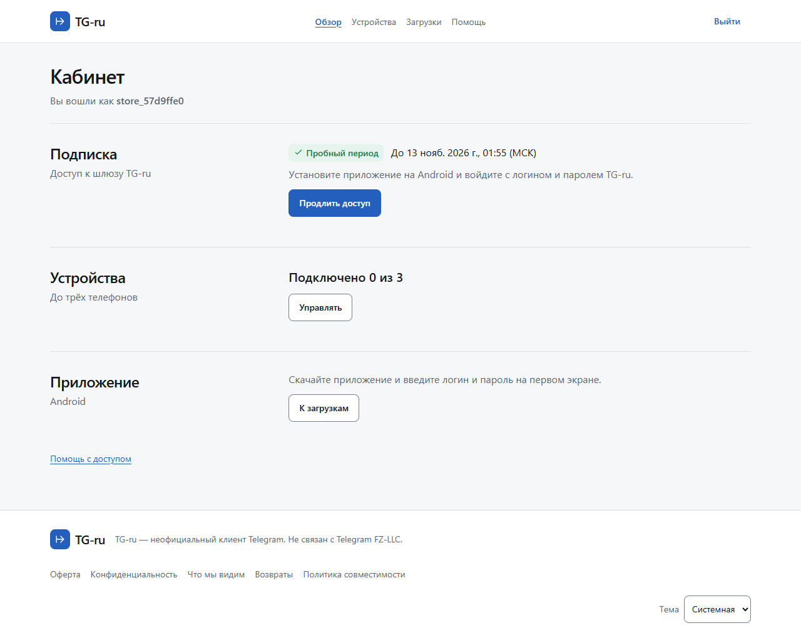
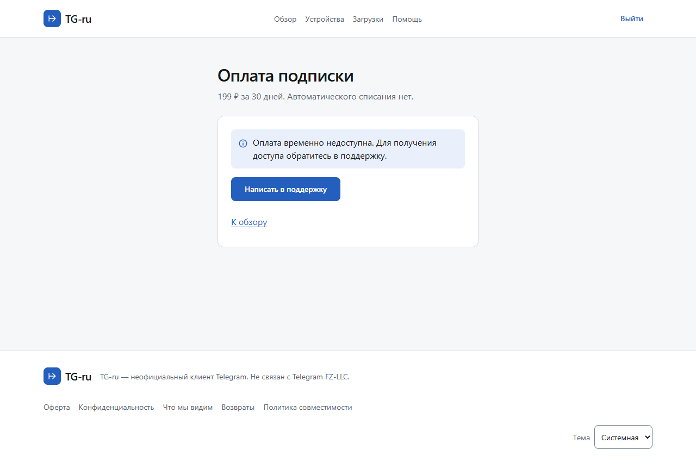

# TG-ru

TG-ru — независимый Android-клиент Telegram со своим шлюзом. Через приложение можно пользоваться чатами Telegram, просматривать документы и расшифровывать голосовые сообщения на поддерживаемом Android. TG-ru не связан с Telegram FZ-LLC.

В редакции Store доступом к шлюзу управляет кабинет TG-ru. Пользователь создаёт аккаунт, запускает один бесплатный период на **5 часов** или получает доступ через поддержку, затем активирует устройство. Плановая цена — **199 ₽ за 30 дней**, до трёх устройств на аккаунт. Онлайн-оплата временно недоступна. [Поддержка TG-ru](https://t.me/prince_skazki)

## Как подключиться

1. Создать аккаунт TG-ru в кабинете. Сохранить код восстановления, который показывается при регистрации.
2. Запустить пробный период или обратиться в поддержку. Кабинет показывает срок действия доступа и привязанные устройства.
3. Открыть Android-приложение и ввести логин и пароль кабинета. Приложение подтверждает привязку подписью ключа устройства. Пароль TG-ru для обычной работы приложения больше не нужен.
4. Войти в Telegram по номеру телефона или открыть существующий аккаунт. Telegram и TG-ru используют отдельные учётные записи.

Оплата в кабинете пока представлена информационной страницей с контактом поддержки. Ручной доступ выдаёт оператор через консоль. Публичной формы выдачи доступа нет.

## Что работает

| Часть проекта | Что проверено |
| --- | --- |
| Android | Подписанные preview20 и preview21 Store проверены на втором физическом Android. Чаты открываются, режим призрака и доступ к архиву удалённых сообщений убраны. |
| Соединение | На preview19 при отказе WSS получено первое соединение REALITY через 10,63 секунды. Возврат транспорта WSS зафиксирован через 600,23 секунды. На Store открытый чат сохранился после 82 секунд без связи с кабинетом. |
| Кабинет | Локальный сервис поддерживает регистрацию, вход, восстановление по коду, пробный доступ, привязку и отвязку устройства. |
| Шлюз | Существующие Android preview продолжают использовать прежний протокол допуска. Совместимость preview9–17 проверена на HTTP-контракте двух ревизий шлюза. |
| Store и оплата | На телефоне проверены отказ без доступа, активация пятичасовой пробы, ручная выдача из консоли, экран входа в Telegram на чистом профиле и открытие существующей сессии. Рабочий шлюз пока использует прежний допуск устройства. |

## Скриншоты

**Android на тестовом телефоне**

| Первый запуск | Активация TG-ru | Устройство подключено | Вход в Telegram |
| --- | --- | --- | --- |
|  |  |  |  |

**Сайт и кабинет**

| Главная | Пробный период | Страница оплаты |
| --- | --- | --- |
|  |  |  |

[Все снимки сайта в светлой и тёмной темах](qa/local-store/)

## Как устроен проект

- Android хранит закрытый ключ устройства в Android Keystore. Сервер хранит открытый ключ и проверяет одноразовые подписанные запросы. Истёкший или отозванный доступ нельзя продлить прежним запросом.
- Шлюз пересылает зашифрованный MTProto-трафик. При маршрутизации он обрабатывает IP-адрес и сетевые метаданные. Кабинет не принимает номера телефонов, коды входа в Telegram и содержимое переписки. Обычные облачные чаты и секретные чаты используют разные режимы шифрования Telegram.
- При потере сети уже загруженные чаты остаются доступны. Если разрешено автопереключение, Android может попробовать запасной маршрут и позднее вернуться на WSS.
- Подписки, сеансы кабинета и привязки устройств хранятся отдельно от шлюза. Тестовая оплата доступна только в явно включённом локальном режиме. Будущий провайдер оплаты — Platega.

## Локальный запуск

Нужен Node.js 24. Команда запускает кабинет и API на loopback. База создаётся в локальном каталоге, исключённом из Git.

```powershell
node local-store/main.mjs
```

Открыть [главную страницу](http://127.0.0.1:48185/) или [кабинет](http://127.0.0.1:48185/cabinet). Android-сборка для локальной проверки обращается к этому адресу через USB. Для сборки APK нужен проверенный базовый APK и локальная подпись Android. [Сборка Android](docs/BUILD.md) · [Проверка подключения](docs/ROUTE-FAILOVER.md)

Для проверки на Android задайте в `$testDevice` идентификатор тестового устройства из `adb devices` и пробросьте порт по USB.

```powershell
adb -s $testDevice reverse tcp:48185 tcp:48185
```

Оператор с доступом к консоли может выдать ручной доступ на 1–365 дней. Укажите логин из кабинета. Выдача попадает в журнал. Ограничение — три выдачи за 24 часа.

```powershell
node local-store/owner.mjs grant demo_user 30 --reason gift
```

```powershell
node --test local-store/store.test.mjs web/local-store/pages.test.mjs tests/compat/preview.test.mjs billing/test/database.test.mjs foundation/test/services.test.mjs
```

[Правила безопасности](SECURITY.md) · [Границы доверия](THREAT_MODEL.md) · [Пробный период](docs/STORE-TRIAL.md) · [Журнал разработки](docs/WORKLOG.md)
