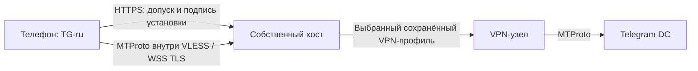
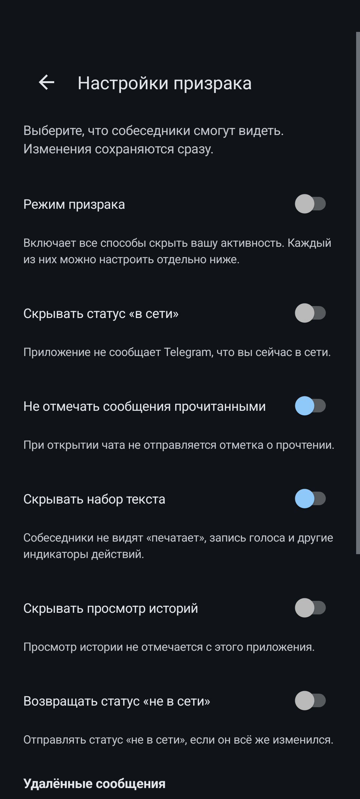
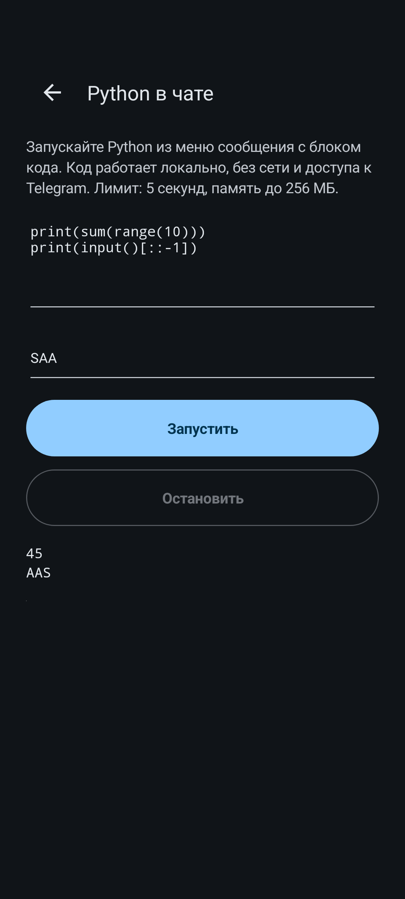
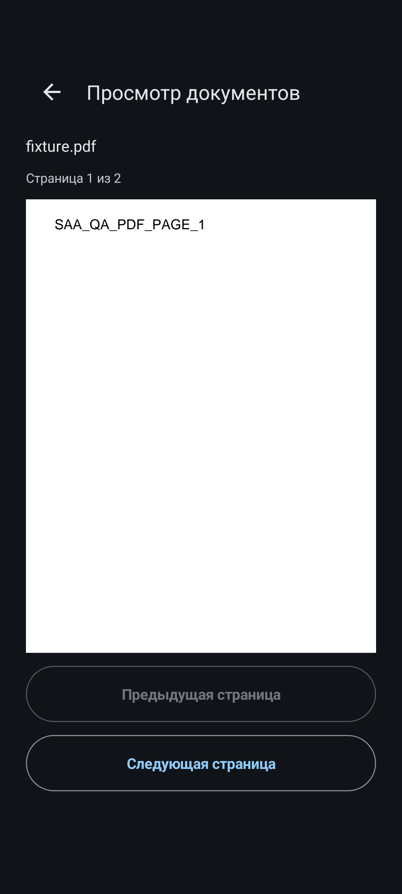
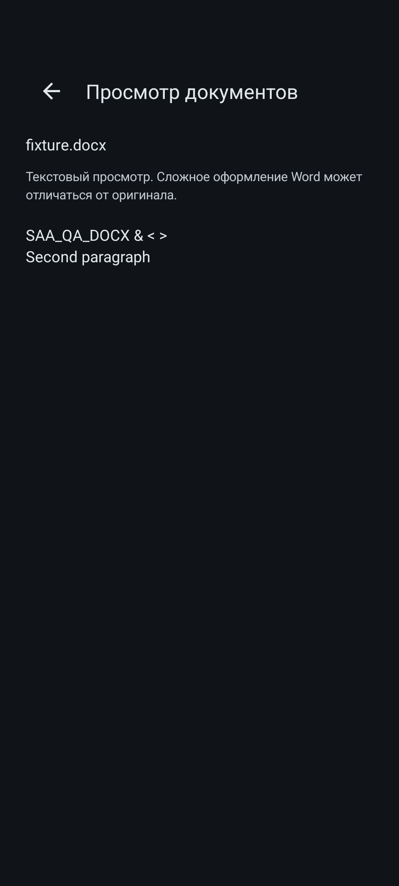

# TG-ru · S.A.A.

Семейный Android-клиент Telegram с привычным интерфейсом, собственным шлюзом подключения и управляемым доступом устройств. Название приложения — **TG-ru**, файл установки — **TG-ru.apk**, заголовок главного экрана — **S.A.A.**

Это приватный проект личного аккаунта **Salatik-s**. Репозиторий не предназначен для публикации. Код и документация не содержат ключ подписи APK, Telegram-сессии, коды входа, приглашения или VPN-профили.

## Проверенная Android-сборка

**0.1.0-preview9** · versionCode **10009** · **150 013 499 байт**. Файл `TG-ru.apk` доступен во вложениях приватного [Release v0.1.0-preview9](https://github.com/Salatik-s/TG-ru/releases/tag/v0.1.0-preview9).

```text
SHA-256: f3ccad9e4ee3ee1554c5d1c276fbf8e0308e88920947a064e4797ec23aa08ea1
```

[Подробный отчёт финального APK на телефоне](qa/saved-media/RESULT.md). Собственная документация исходного проекта сохранена в [docs/PROJECT.md](docs/PROJECT.md); контрольные суммы перенесённых исходников — в [docs/SOURCE-SNAPSHOT.json](docs/SOURCE-SNAPSHOT.json).

## Что умеет

- Подключается через собственный сервер и сохранённый на нём VPN-маршрут. Отдельный VPN на телефоне для этого пути не требуется.
- Допускает новое устройство только по одноразовому приглашению и одобрению владельца.
- Позволяет привязанному телефону владельца создавать приглашения, одобрять и отзывать устройства.
- Содержит настройки режима призрака и локального сохранения удалённых сообщений.
- Запускает Python из блока кода сообщения в локальной среде с ограничениями времени, памяти и доступа.
- Открывает PDF, Word, ODT, RTF и текстовые документы внутри приложения.
- Сохраняет существующий менеджер сторонних плагинов исходного клиента.

Встроенные дополнения Python и просмотра документов установлены вместе с APK и **выключены по умолчанию**. Их можно включить в настройках. Выполнение Python начинается только после явного нажатия «Запустить»; результат не отправляется собеседнику.

## Как проходит подключение



На первом запуске приложение создаёт собственный ключ установки в Android Keystore. Приглашение открывает ожидание допуска; владелец сравнивает отпечаток и одобряет устройство. После допуска пользователь входит в свой Telegram-аккаунт обычным способом. Хост не выполняет вход в Telegram за пользователя и не хранит его Telegram-сессию.

Основной транспорт использует `https://24projects.ru:8443/v1/transport` с проверкой сертификата. Legacy REALITY на TCP 18443 сохранён для совместимости. На хосте проверяется рабочий маршрут через сохранённые VPN-профили. При отказе выбранного маршрута проверяются другие доступные узлы. Если хост или все маршруты недоступны, работа останавливается: бесконечную доступность это устройство не гарантирует.

Подробнее: [сеть, данные и права](docs/ARCHITECTURE.md), [сборка и обновление](docs/BUILD.md), [проверки и ограничения](docs/VALIDATION.md).

## Где находятся настройки

- На главном экране рядом с **S.A.A.**: **⋮ → Настройки призрака**. Здесь собраны режим призрака, отдельные переключатели активности и история удалённых сообщений.
- **Настройки → Плагины**: встроенные Python и документы, а также переход к другим плагинам.
- **Настройки → Устройства семьи**: приглашения и допуск устройств. Пункт доступен только привязанному телефону владельца; сервер проверяет права каждого действия.
- **Системные настройки** находятся в самом низу настроек, после обычных пользовательских разделов. Там собраны технические параметры подключения и дополнительные настройки исходного клиента.

Изменения переключателей сохраняются сразу. Сложные сетевые сведения не нужны для обычной переписки.

## Скриншоты приложения

Реальные экраны Android с собственными синтетическими тестовыми данными. Личных чатов, телефонов, приглашений и ключей на них нет.


| Настройки призрака | Уже установленные дополнения |
|---|---|
|  |  |

| Python: локальный результат | PDF: постраничный просмотр | Word: текстовый просмотр |
|---|---|---|
|  |  |  |

## Функции и их границы

**Призрак.** Переключатели управляют отправкой выбранных событий: прочтение, набор текста, онлайн. Возможности зависят от поведения Telegram. Это не обещание полной невидимости во всех сценариях.

**Удалённые сообщения.** История хранит сообщения, которые приложение получило до удаления и сохранило локально. Она не восстанавливает ранее удалённую серверную историю. Получение на другом устройстве само по себе не означает наличие копии здесь.

**Python.** Среда CPython/Pyodide поставляется в APK, CDN не нужен. Новый worker на каждый запуск, виртуальная файловая система, запрет внешней сети, отсутствие JavaScript-моста к Android, лимит исполнения 5 секунд, WASM-памяти 256 МиБ и вывода 64 КиБ. Автоматической установки пакетов нет.

**Документы.** PDF отображается постранично; DOC/DOCX/ODT/RTF и текст — в текстовом виде. Сложное оформление Word может отличаться. Обработка проходит в отдельном изолированном Android-процессе по дескриптору только для чтения; онлайн-просмотрщик и исполнение макросов не используются. Максимум файла — 32 МиБ.

**Сторонние плагины.** Обычный менеджер плагинов сохранён. Его плагины остаются доверенным кодом приложения; ограничения встроенного Python не распространяются автоматически на произвольный сторонний плагин.

## Состав репозитория

| Каталог | Назначение |
|---|---|
| `overlay/` | Android-экраны доступа и настроек, управление устройствами, встроенные дополнения |
| `server/` | API, SQLite, доказательства владения ключом, одноразовые приглашения, права владельца |
| `deploy/` | Изолированная установка и обновление собственного хоста, диагностика |
| `tunnel/` | Встроенный транспорт и Xray, TCP/UDP, WSS/REALITY |
| `native/` | Интеграция закреплённого Telegram MTProto networking |
| `calls/` | Нативный адаптер сетевых сокетов звонков и отдельные стенды |
| `build-support/` | Подготовка APK, компиляция overlay, проверки DEX/ресурсов/подписи |
| `qa/` | Отдельные тестовые приложения и стенды; в пользовательский APK не входят |

## Основа и сборка

Основа — [exteraless v13.1.1-beta15](https://github.com/exteraless/exteraless/releases/tag/v13.1.1-beta15), Telegram 13.1.1, commit `c83765c4151d50ba514325ddf0a3262769729dc6`. Исходный APK и нативные входы закреплены контрольными суммами. Текущая поставка собирается из закреплённого APK с компиляцией собственных Java/Go/C++-компонентов и проверяемыми изменениями ресурсов/smali. Полная upstream-сборка Gradle на этом этапе не завершена.

Внутренний application ID — `com.salatik.familygram`. Его и ключ подписи необходимо сохранять при обновлениях, чтобы не потерять совместимость установленного приложения и идентичность допуска. Приватный ключ хранится вне Git и не должен загружаться сюда даже при приватной видимости репозитория.

APK размером свыше лимита обычного Git хранится отдельным вложением приватного Release. Подписанный файл не коммитится в историю исходников.

## Проверено и что остаётся

На финальном APK preview9 на физическом Android 15 повторно проверены загрузка файлов 128 КиБ и 12 МиБ + 197 байт с новым скачиванием и SHA-256, отправка и свежая загрузка фотографии, цикл допуска/отзыва временного устройства, ограничения прав владельца, запуск Python из меню реального тестового сообщения и просмотр PDF/DOC/DOCX/ODT/RTF/TXT. Удаление собственного тестового сообщения сохранилось в локальной истории. Все отправки были только в «Избранное».

Пять производственных Telegram DC ответили на MTProto-проверку через публичный WSS и серверный VPN. Звонки с собеседником, камера/микрофон, длительная фоновая доставка и все сочетания внешнего VPN на телефоне пока не подтверждены этими тестами. iOS/IPA относится к следующему этапу.

На финальном Android preview9 также проверены видимый заголовок S.A.A., настоящий клик в ⋮ → Настройки призрака, связь переключателей с реальными фильтрами и положение системных настроек внизу списка. Python и все шесть форматов документов повторно проверены на этом APK.

Точные версии, контрольные суммы и границы результатов фиксируются в отчёте соответствующей сборки, а не переносятся автоматически на будущие версии.
