# TG-ru

> **Сайт проекта:** [tg.24projects.ru](https://tg.24projects.ru/)

TG-ru — независимый Android-клиент Telegram со своим шлюзом. Через приложение можно пользоваться чатами Telegram, просматривать документы и расшифровывать голосовые сообщения на поддерживаемом Android. TG-ru не связан с Telegram FZ-LLC.

В редакции Store доступом к шлюзу управляет кабинет TG-ru. DEMO даёт **5 часов** и до двух устройств. START стоит **199 ₽ за 30 дней** и поддерживает до трёх устройств, PRO — **500 ₽ за 90 дней** и до четырёх устройств. Пока онлайн-оплата недоступна, START и PRO выдаёт владелец. [Поддержка TG-ru](https://t.me/prince_skazki)

## Как подключиться

1. Создать аккаунт TG-ru в кабинете. Сохранить код восстановления, который показывается при регистрации.
2. Запустить пробный период или обратиться в поддержку. Кабинет показывает срок действия доступа и привязанные устройства.
3. Открыть Android-приложение и ввести логин и пароль кабинета. Приложение подтверждает привязку подписью ключа устройства. Пароль TG-ru для обычной работы приложения больше не нужен.
4. Войти в Telegram по номеру телефона или открыть существующий аккаунт. Telegram и TG-ru используют отдельные учётные записи.

На странице оплаты указан контакт поддержки. В отдельном кабинете владелец может создать аккаунт с START или PRO, продлить и отозвать доступ. Для входа нужны отдельный пароль и одноразовый код.

## Что работает

| Часть проекта | Что проверено |
| --- | --- |
| Android | Preview23 Store поддерживает активацию по логину и паролю TG-ru и вход в Telegram по номеру телефона. |
| Кабинет | Регистрация, вход, восстановление по коду, пятичасовой DEMO и управление устройствами. |
| Шлюз | Store принимает подписанные допуски и выдаёт профиль WSS на 443. Для preview22 поддерживается профиль REALITY. |
| Оплата | Кабинет направляет в поддержку. Доступ выдаёт владелец. |
| Публикация | Preview23 скачивается из [кабинета на tg.24projects.ru](https://tg.24projects.ru/downloads). Прежние маршруты preview17 действуют. |

На втором Android с чистых профилей проверены пятичасовая проба и ручная выдача из консоли. В обоих случаях шлюз передал трафик Telegram в обе стороны, приложение дошло до экрана номера телефона.

## Дополнительные функции в чатах

Функции доступны в приложении с DEMO, START и PRO. Встроенные инструменты включаются через **Настройки → Плагины**.

- **Расшифровка голосовых и кружочков.** Текст открывается под записью. В настройках можно выбрать Telegram Premium или локальное распознавание. Локальный вариант зависит от совместимости системной службы и установленных языков Android.
- **Просмотр документов.** PDF с масштабированием и перелистыванием, Word (DOC/DOCX), ODT, RTF и TXT открываются внутри приложения. Таблицы из Excel можно открыть как CSV после экспорта.
- **Python в чате.** Нажмите «Запустить» под блоком Python. Вывод или ошибка появятся под сообщением. Код выполняется локально, без доступа к сети или объектам Telegram.
- **Дополнительные плагины.** Откройте «Другие плагины», чтобы управлять дополнениями или импортировать их через меню ⋮.

Снимки из preview23 на Android. Для примеров использованы тестовые сообщения в «Избранном» и тестовые документы.

| Настройки плагинов | Просмотр PDF | Просмотр Word |
| --- | --- | --- |
| 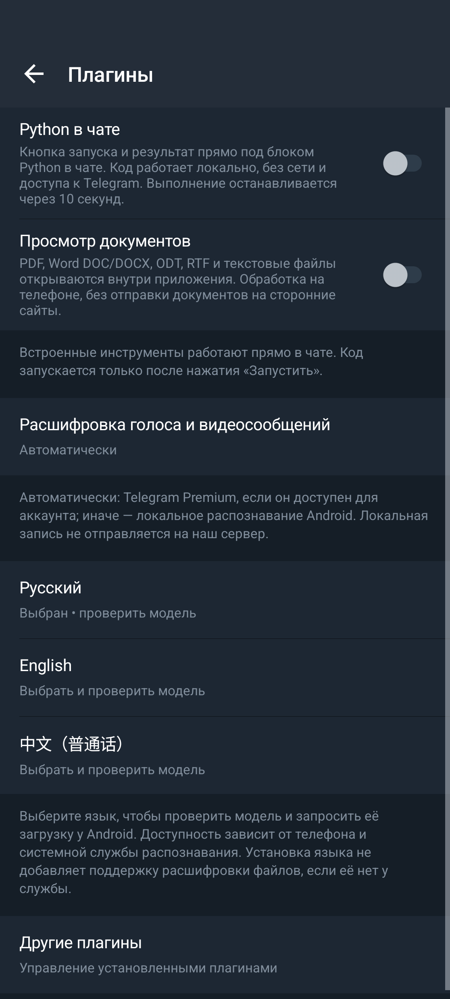 | 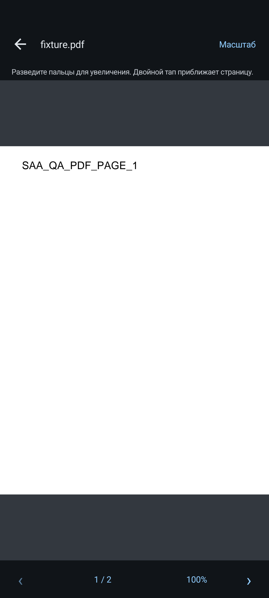 |  |

| Python под сообщением | Расшифровка под голосовым |
| --- | --- |
| 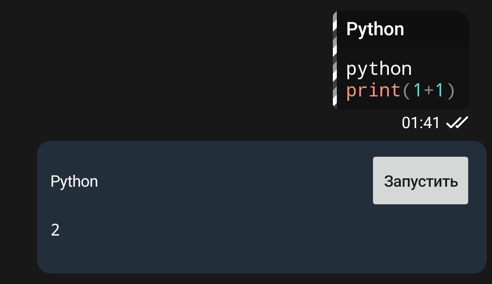 |  |

[Выбор способа расшифровки](docs/qa/store/features/speech-provider.png) · [Ошибка Python в чате](docs/qa/store/features/python-error.png) · [Просмотр TXT](docs/qa/store/features/txt-viewer.png) · [Меню импорта плагинов](docs/qa/store/features/plugin-import.png)

## Скриншоты

**Android на тестовом телефоне**

| Первый запуск | Активация TG-ru | Устройство подключено | О данных |
| --- | --- | --- | --- |
| 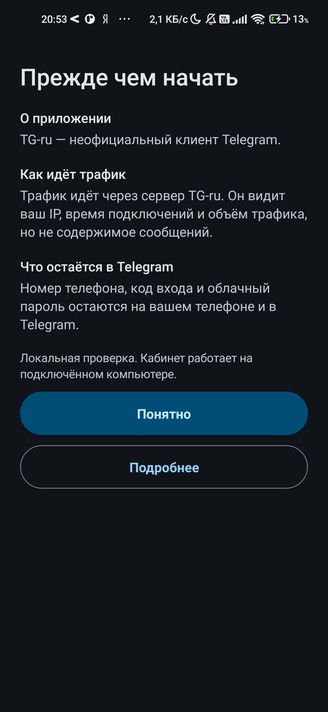 | 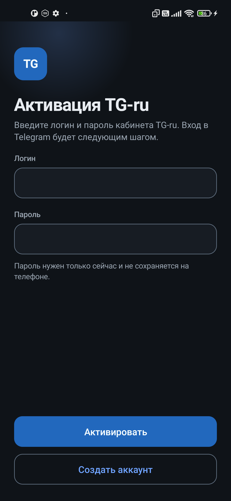 | 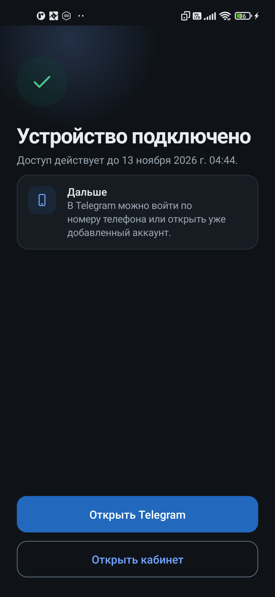 | 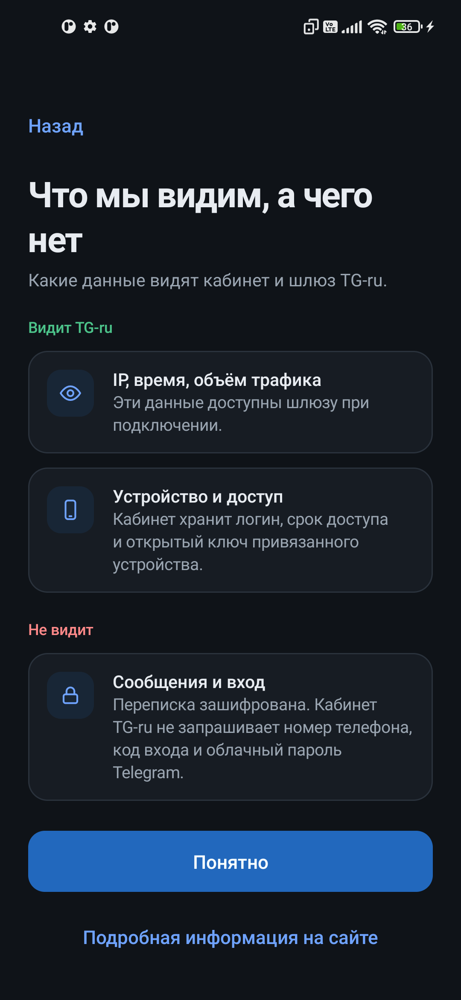 |

[Ручная выдача](docs/qa/store/android-manual-activated.png) · [Вход в Telegram](docs/qa/store/android-telegram-sign-in.png)

**Сайт и кабинет**

| Главная | Регистрация | Кабинет | Страница оплаты |
| --- | --- | --- | --- |
| 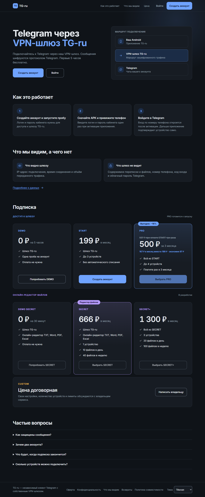 | 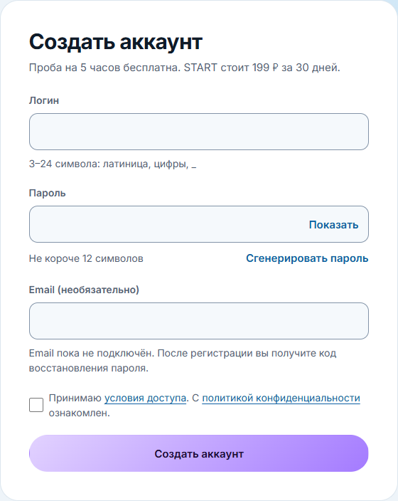 | 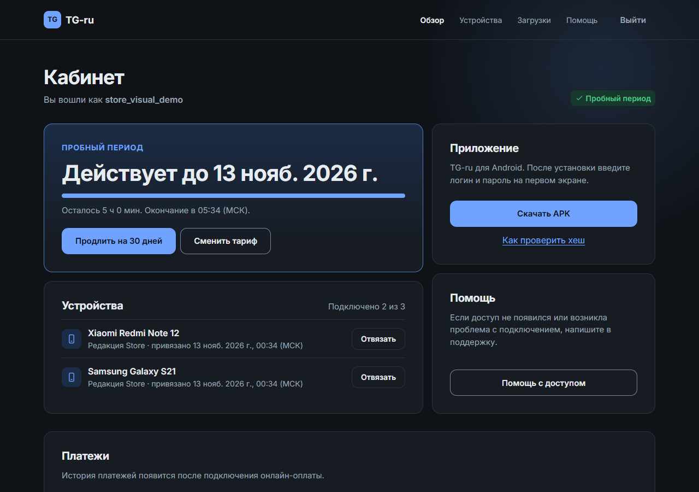 | 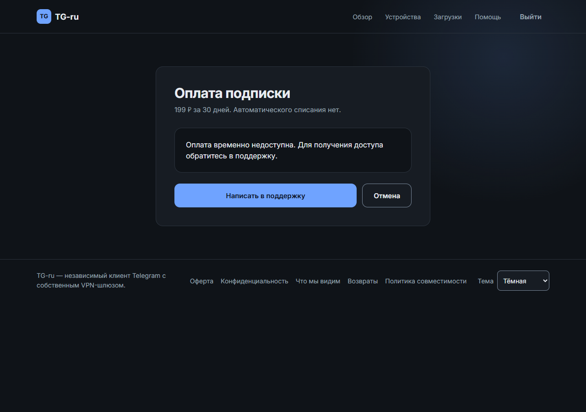 |

[Главная на телефоне](docs/qa/store/web-mobile-home.png) · [Кабинет на телефоне](docs/qa/store/web-mobile-cabinet.png)

## Как устроен проект

- Android хранит закрытый ключ устройства в Android Keystore. Сервер хранит открытый ключ и проверяет одноразовые подписанные запросы. Истёкший или отозванный доступ нельзя продлить прежним запросом.
- Шлюз пересылает зашифрованный MTProto-трафик. При маршрутизации он обрабатывает IP-адрес и сетевые метаданные. Кабинет не принимает номера телефонов, коды входа в Telegram и содержимое переписки. Обычные облачные чаты и секретные чаты используют разные режимы шифрования Telegram.
- При краткой потере сети уже загруженные чаты остаются доступны. Preview23 использует WSS на порту 443, когда шлюз выдаёт соответствующий профиль. Старые сборки сохраняют свои маршруты.
- Подписки, сеансы кабинета и привязки устройств хранятся отдельно от шлюза. Тестовая оплата доступна только в явно включённом локальном режиме. Будущий провайдер оплаты — Platega.

## Локальный запуск

Нужен Node.js 24. Команда запускает кабинет и API на loopback. База создаётся в локальном каталоге, исключённом из Git.

```powershell
node local-store/main.mjs
```

Открыть [главную страницу](http://127.0.0.1:48185/) или [кабинет](http://127.0.0.1:48185/cabinet). Для проверки доступа с APK запустите также выделенный шлюз. Для сборки APK нужен проверенный базовый APK и локальная подпись Android. [Запуск шлюза Store](docs/STORE-GATEWAY.md) · [Сборка Android](docs/BUILD.md)

Для проверки на Android задайте в `$testDevice` идентификатор тестового устройства из `adb devices` и пробросьте порт по USB.

```powershell
adb -s $testDevice reverse tcp:48185 tcp:48185
adb -s $testDevice reverse tcp:28443 tcp:28443
```

Оператор с доступом к консоли может выдать ручной доступ на 1–365 дней. Укажите логин из кабинета. Выдача попадает в журнал. Ограничение — три выдачи за 24 часа.

```powershell
node local-store/owner.mjs grant demo_user 30 --reason gift
```

```powershell
node --test local-store/store.test.mjs web/local-store/pages.test.mjs tests/compat/preview.test.mjs billing/test/database.test.mjs foundation/test/services.test.mjs
```

[Правила безопасности](SECURITY.md) · [Границы доверия](THREAT_MODEL.md) · [Пробный период](docs/STORE-TRIAL.md) · [Журнал разработки](docs/WORKLOG.md)

[Публикация сайта и APK на хосте](deploy/store/README.md)
