# TG-ru

Android-клиент Telegram с собственным шлюзом и допуском устройств по приглашению. Название приложения — **TG-ru**, файл установки — **TG-ru.apk**. Заголовок чатов выбирается нажатием на него.

Приватный проект аккаунта **Salatik-s**.

## Android 0.1.0-preview17

VersionCode **10018** · **159 315 814 байт** · SHA-256 `fe8f6e173b672a178ff44f582d6017d91a77256526afddb92f1acaac67a1daa5`.

- Уже загруженные чаты остаются доступны при потере сети. После восстановления связи приложение заново проверяет доступ к серверу.
- При длительном сбое WSS клиент пробует доступный профиль REALITY после успешной проверки допуска. Через десять минут он повторяет попытку через WSS. Доступность сайта загрузок и API на 8443 проверяется отдельно.
- **Настройки → Системные настройки → Записать диагностику** включает ограниченный журнал на 24 часа. Журнал хранится на телефоне и включает только состояния сети, проверки доступности и числовые счётчики звонков.
- Призрак и плагины оформлены в одном стиле. В плагинах доступен выбор способа расшифровки и запрос Android на загрузку моделей русского, английского и китайского языков. Возможность обработки аудиофайлов зависит от системной службы.
- Восстановлен подсчёт непрочитанных по правилам каждой папки.

На Android 15 проверены тёплый и холодный запуск без сети, сохранение открытого «Избранного» и черновика после восстановления сети, оба ручных способа расшифровки и повторная загрузка удалённой русской модели через системное окно Android. Реальный звонок через VPN хоста остаётся отдельной проверкой.

[Проверка безопасности](design/security-audit-2026-11-12.md) · [Диагностика звонков](calls/AUDIT-2026-11-12.md) · [Архивная сборка preview12](https://github.com/Salatik-s/TG-ru/releases/tag/v0.1.0-preview12).

## Что умеет

- Подключается через собственный сервер и сохранённый на нём VPN-маршрут. Отдельный VPN на телефоне для этого пути не требуется.
- Допускает новое устройство только по одноразовому приглашению и одобрению владельца.
- Позволяет привязанному телефону владельца создавать приглашения, одобрять и отзывать устройства.
- Содержит настройки режима призрака и локального сохранения удалённых сообщений.
- Запускает Python кнопкой под сообщением с кодом и показывает локальный результат там же, с ограничениями времени, памяти и доступа.
- Открывает PDF с масштабированием и навигацией; DOCX/ODT отображает локально с основными элементами оформления; DOC/RTF и текст сохраняют упрощённый просмотр.
- Использует системное on-device распознавание голосовых сообщений и видеокружков через штатную кнопку Telegram; результат появляется в штатной подписи сообщения и остаётся локальным.
- Сохраняет существующий менеджер сторонних плагинов исходного клиента.

Встроенные дополнения Python и просмотра документов установлены вместе с APK и **выключены по умолчанию**. Их можно включить в настройках. Выполнение Python начинается только после явного нажатия «Запустить» под сообщением; результат показывается локально под ним и не отправляется собеседнику. Для основного сценария отдельный экран редактора не открывается. Панель результата расширена, текст 15 sp; длинный вывод можно раскрыть стандартным диалогом.

## Как проходит подключение

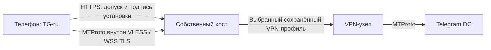

На первом запуске приложение создаёт собственный ключ установки в Android Keystore. Приглашение открывает ожидание допуска; владелец сравнивает отпечаток и одобряет устройство. После допуска пользователь входит в свой Telegram-аккаунт обычным способом. Хост не выполняет вход в Telegram за пользователя и не хранит его Telegram-сессию.

Основной транспорт использует `https://24projects.ru:8443/v1/transport` с проверкой сертификата. Legacy REALITY на TCP 18443 сохранён для совместимости. На хосте проверяется рабочий маршрут через сохранённые VPN-профили. При отказе выбранного маршрута проверяются другие доступные узлы. Если хост или все маршруты недоступны, работа останавливается: бесконечную доступность это устройство не гарантирует.

Подробнее: [сеть, данные и права](docs/ARCHITECTURE.md), [документы и масштабирование](docs/OFFICE.md), [системная расшифровка и её ограничения](docs/NATIVE-SPEECH.md), [сборка и обновление](docs/BUILD.md), [проверки и ограничения](docs/VALIDATION.md).

## Где находятся настройки

- На главном экране: **⋮ → Настройки призрака**. Здесь собраны режим призрака, отдельные переключатели активности и история удалённых сообщений.
- **Настройки → Плагины**: встроенные Python и документы, а также переход к другим плагинам.
- **Настройки → Устройства семьи**: приглашения и допуск устройств. Пункт доступен только привязанному телефону владельца; сервер проверяет права каждого действия.
- **Системные настройки** находятся в самом низу настроек, после обычных пользовательских разделов. Там собраны технические параметры подключения и дополнительные настройки исходного клиента.

Изменения переключателей сохраняются сразу. Сложные сетевые сведения не нужны для обычной переписки.

## Скриншоты предыдущих версий

Реальные экраны Android с собственными синтетическими тестовыми данными. Показаны собственные synthetic Python и голосовое сообщение; начальные PDF/Word экраны соответствуют тому же viewer, который отдельно прошёл жестовые проверки на финальном APK. Личных чатов, телефонов, приглашений и ключей на них нет.

| Настройки призрака | Уже установленные дополнения |
|---|---|
| 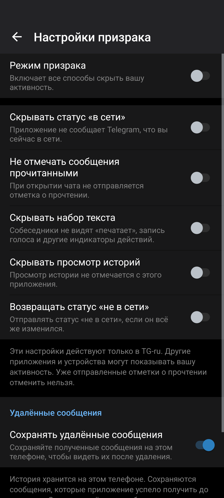 | 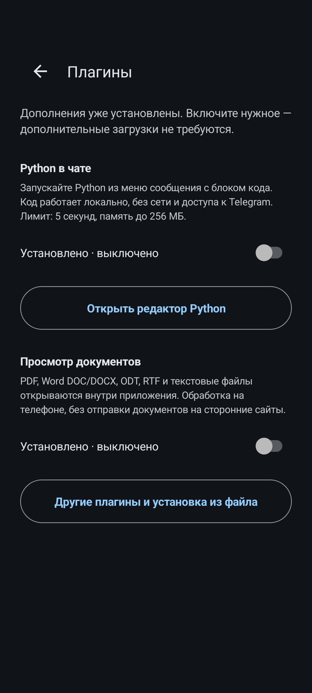 |

| Python: локальный результат под сообщением | PDF: полноэкранный просмотр | DOCX: локальное оформление |
|---|---|---|
| 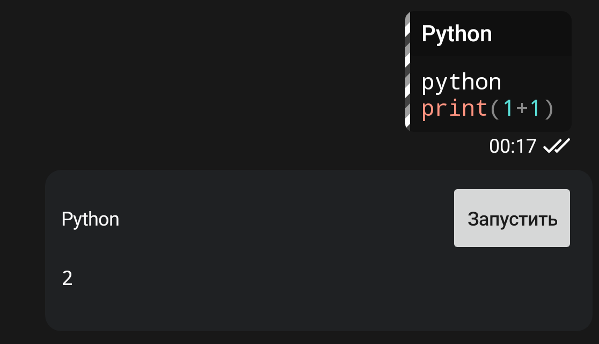 |  | 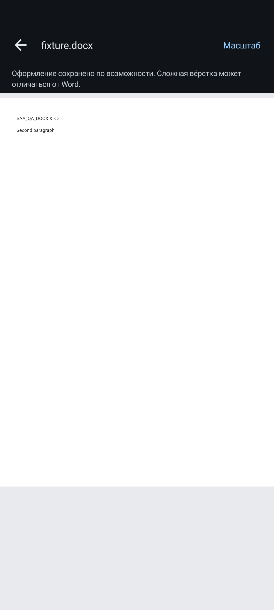 |

### Настройки при увеличенном шрифте

Проверены настоящие семь переключателей, перенос подписей, прокрутка и контраст. При 200% длинный заголовок панели штатно сокращается; названия и пояснения строк доступны полностью через прокрутку.

| Шрифт 100%: нижняя часть | Шрифт 130% | Шрифт 200% |
|---|---|---|
| 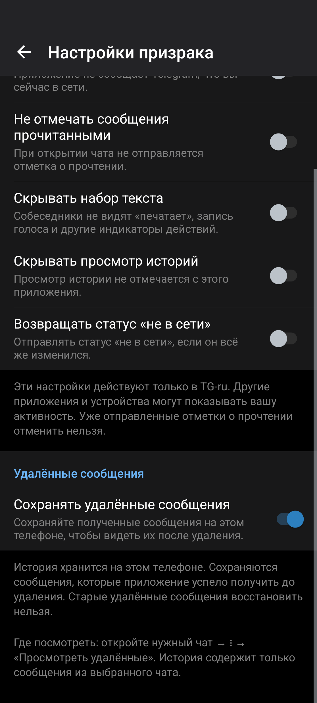 | 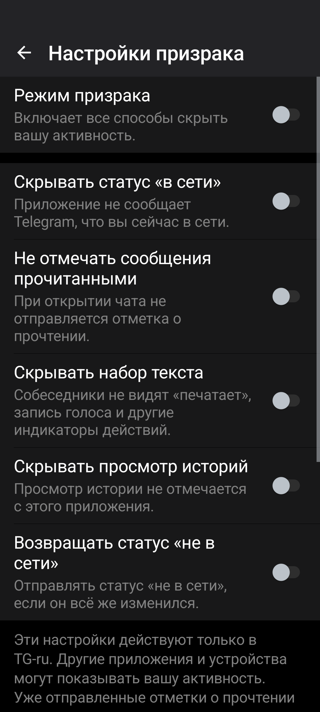 | 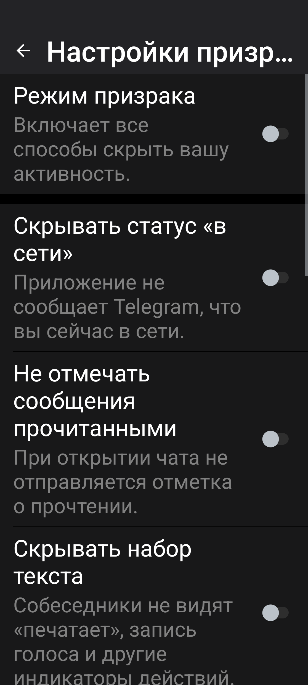 |

### Локальные результаты и штатная транскрипция

| Python: исходная ошибка | Python: раскрытый вывод | Штатная подпись голосового |
|---|---|---|
| 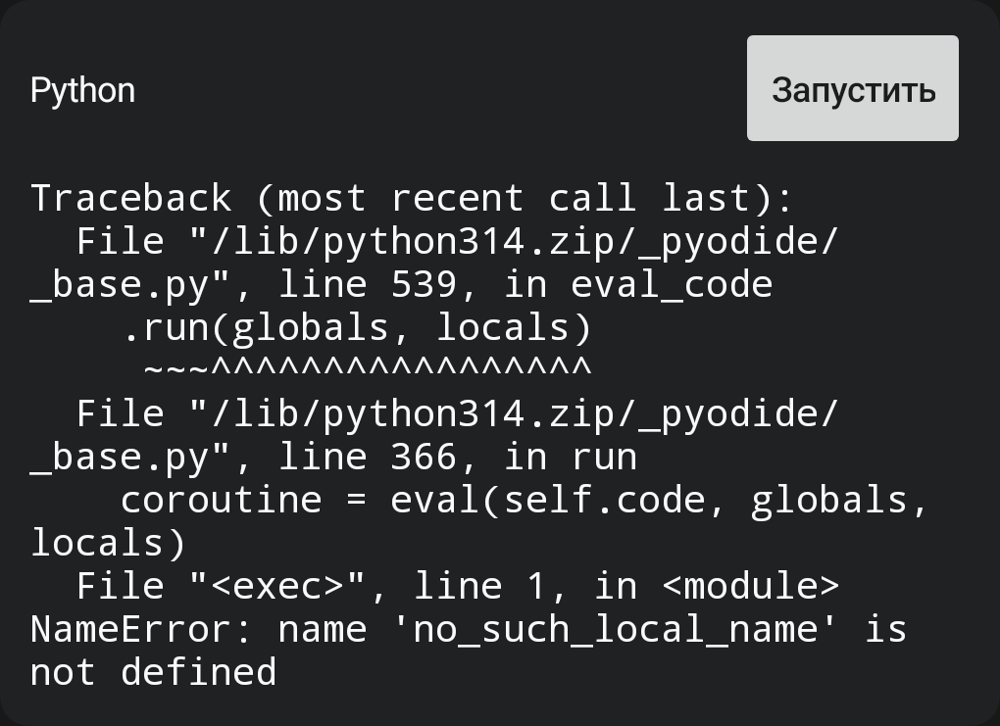 | 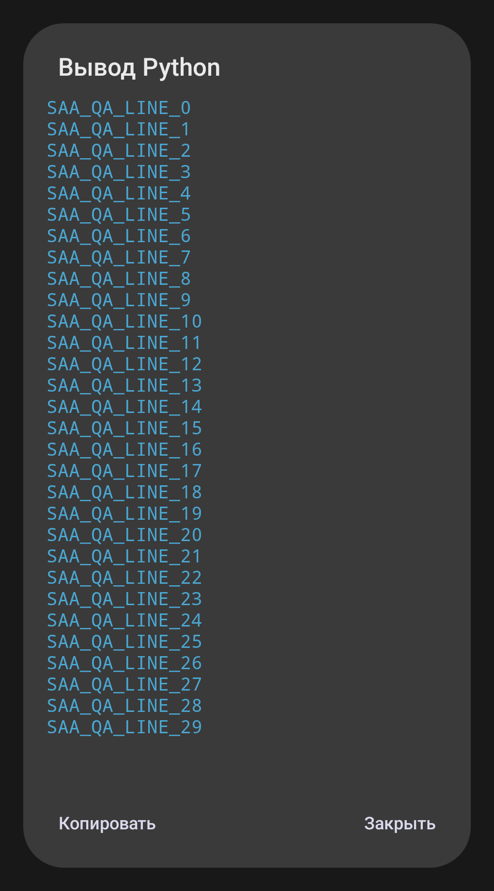 | 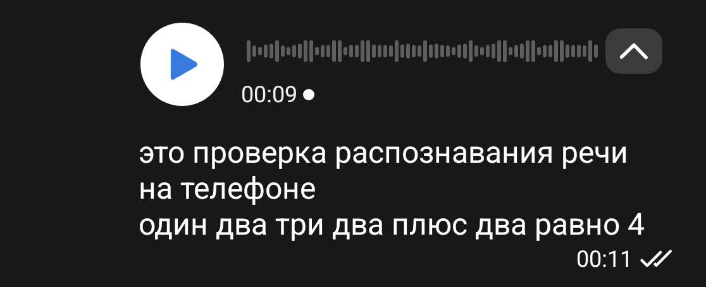 |

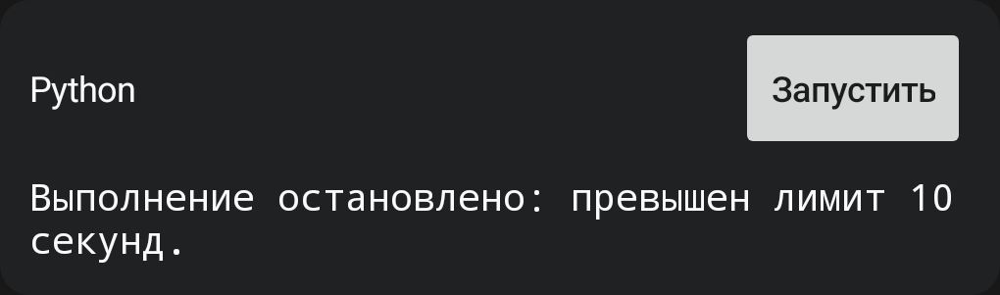

## Функции и их границы

**Призрак.** Переключатели управляют отправкой выбранных событий: прочтение, набор текста, онлайн. Возможности зависят от поведения Telegram. Это не обещание полной невидимости во всех сценариях.

**Удалённые сообщения.** История хранит сообщения, которые приложение получило до удаления и сохранило локально. Она не восстанавливает ранее удалённую серверную историю. Получение на другом устройстве само по себе не означает наличие копии здесь.

**Python.** Среда CPython/Pyodide поставляется в APK, CDN не нужен. Новый worker на каждый запуск, виртуальная файловая система, запрет внешней сети, отсутствие JavaScript-моста к Android, лимит исполнения 10 секунд, WASM-памяти 256 МиБ и вывода 64 КиБ. Автоматической установки пакетов нет.

**Документы.** PDF открывается на весь экран: pinch, двойной тап, перемещение увеличенной страницы, подгонка и переход к номеру страницы. После увеличения запрашивается повторный рендер большего разрешения. Для DOCX/ODT локальный renderer сохраняет поддерживаемые абзацы, основные стили текста, таблицы и ограниченные встроенные изображения; это не полный движок Microsoft Word. DOC/RTF остаются упрощённым текстовым просмотром. Разбор выполняется в отдельном изолированном Android-процессе по дескриптору чтения. Сеть и JavaScript в окне документа отключены, макросы не исполняются. Максимум файла — 32 МиБ. [Подробные границы](docs/OFFICE.md).

**Расшифровка.** Используется родная кнопка транскрипции голосового сообщения/видеокружка и родная подпись Telegram, без отдельного ASR-экрана. Звук выбранной записи декодируется локально в PCM и передаётся системному on-device SpeechRecognizer через файловый дескриптор. Дополнительной загрузки записи на семейный хост или ASR-сервис нет; Whisper в APK не включён. Проверенная конфигурация — Android 15 с Google AiAi версии 12872254. Другие устройства, версии провайдера и языковые модели требуют отдельной проверки. Если язык отсутствует, предлагается штатная загрузка модели Android; голос для этого не выгружается. Результат хранится в ограниченном кэше памяти, не записывается в MessagesStorage и не отправляется на сервер Telegram. [Требования и ограничения](docs/NATIVE-SPEECH.md).

**Сторонние плагины.** Обычный менеджер плагинов сохранён. Его плагины остаются доверенным кодом приложения; ограничения встроенного Python не распространяются автоматически на произвольный сторонний плагин.

## Состав репозитория

| Каталог | Назначение |
|---|---|
| `overlay/` | Android-экраны доступа и настроек, управление устройствами, встроенные дополнения |
| `server/` | API, SQLite, доказательства владения ключом, одноразовые приглашения, права владельца |
| `deploy/` | Изолированная установка и обновление собственного хоста, диагностика |
| `tunnel/` | Встроенный транспорт и Xray, TCP/UDP, WSS/REALITY |
| `native/` | Интеграция закреплённого Telegram MTProto networking |
| `calls/` | Нативный адаптер сетевых сокетов звонков и отдельные стенды |
| `build-support/` | Подготовка APK, компиляция overlay, проверки DEX/ресурсов/подписи |
| `qa/` | Отдельные тестовые приложения и стенды; в пользовательский APK не входят |

## Основа и сборка

Основа — [exteraless v13.1.1-beta15](https://github.com/exteraless/exteraless/releases/tag/v13.1.1-beta15), Telegram 13.1.1, commit `c83765c4151d50ba514325ddf0a3262769729dc6`. Исходный APK и нативные входы закреплены контрольными суммами. Текущая поставка собирается из закреплённого APK с компиляцией собственных Java/Go/C++-компонентов и проверяемыми изменениями ресурсов/smali. Полная upstream-сборка Gradle на этом этапе не завершена.

Внутренний application ID — `com.salatik.familygram`. Его и ключ подписи необходимо сохранять при обновлениях, чтобы не потерять совместимость установленного приложения и идентичность допуска. Приватный ключ хранится вне Git и не должен загружаться сюда даже при приватной видимости репозитория.

APK размером свыше лимита обычного Git хранится отдельным вложением приватного Release. Подписанный файл не коммитится в историю исходников.

## Python: ошибки и время

В preview11 выполнение кода ограничено **10 секундами**. Начальная загрузка локального runtime имеет отдельное окно до **30 секунд**; превышение этого окна не выдаётся за слишком долгий пользовательский код. В выводе различаются `SyntaxError`, `NameError` и traceback. Ошибка bootstrap не маскируется как успешное выполнение.

## Проверено и что остаётся

**Финальный preview12:** собственное FGS-уведомление проверено по настоящему `telegram_connected=true`, тихому прежнему каналу и служебным флагам. Настройки прошли 100/130/200% font-scale, контраст пояснений ≥4.5 и выключенного thumb/track ≥3, whole-row click и checkable accessibility. Прочтение и набор текста изменяли реальные фильтры, после теста исходные значения восстановлены. Навигация и UI владельца прошли, выбранные плагины сохранены.

Все восемь upstream DEX и 4301 файл assets/lib побайтово совпали с закреплённым preview11. Шесть семейных native-хешей сохранены. Python, ASR, PDF/Office и транспорт не заменялись; их более широкие результаты ниже относятся к preview11.

В preview11 финальная suite Python/context/document прошла за **29 секунд**, навигация и UI владельца — за **5 секунд**. Проверены реальный контекстный запуск в inline-панели без редактора, ошибки/Stop/лимит Python, настоящий PDF pinch выше 150% с повторным render увеличенной ширины, страницы и DOCX zoom; шесть форматов документов открылись. Нативная транскрипция synthetic Opus-записи отображается штатной Telegram-подписью. Проверка temporary non-Premium flag показала кнопку без замка; состояние аккаунта сразу восстановлено.

Системный file-input ASR прошёл на известном Android 15 / AiAi provider при отозванном разрешении микрофона тестового приложения и AppOp IGNORE. Декодер прошёл WAV/AAC/Opus/AVC+AAC MP4, отмену и ошибочные входы; 91 PCM и 25 Office fixtures также прошли. Полные границы и различие candidate/final checks записаны в [отчёте preview11](qa/saved-media/PREVIEW11-RESULT.md).

Проверки неизменённой сети/медиа/owner-cycle/history preview9 сохранены отдельно и не выданы за повторённые тесты preview11. Хост не обновлялся; WSS, VPN-профили, допуски и ключ подписи сохранены.

Реальные звонки с собеседником, все сторонние VPN, длительные фоновые уведомления и произвольные другие Android/ASR-провайдеры не подтверждены. Облачные чаты остаются у Telegram. Локальная история не восстанавливает не полученные сообщения. iOS не входит в Android Release.
